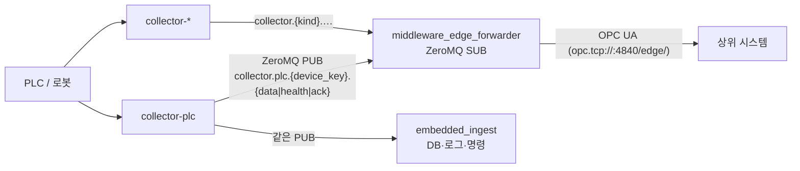

# middleware_edge_forwarder

엣지에서 collector(`collector-plc`, `collector-*`)가 수집한 데이터를 IPC로 넘겨받아 **북향 OPC UA 서버**로 상위 시스템(MES·SCADA 등)에 제공하는 프로세스입니다.

IPC 방식은 아직 확정 전이며, 현재는 collector 레포들이 이미 쓰고 있는 **ZeroMQ PUB/SUB** 기준으로 구현되어 있습니다.

## 전체 구조



- collector는 PUB 소켓을 **bind**, forwarder는 SUB로 **connect** 합니다. ZeroMQ PUB은 여러 SUB에 동시에 전달하므로 `embedded_ingest`와 나란히 붙을 수 있고, collector 쪽 설정은 바꾸지 않아도 됩니다.
- forwarder는 `data`, `health`만 사용합니다. `ack`는 수신 후 버리고, `cmd_r`/`cmd_w`는 보내지 않습니다 (명령 경로는 `embedded_ingest` 담당).

## 구성

```
main.py                    # 진입점: logging → forwarder.run
config.py                  # .env + tag map JSON → settings
forwarder.py               # IPC 수신 → 북향 OPC UA 반영 루프 (DATA/HEALTH 처리, 수신 공백 감시)
client/errors.py           # ClientError (collector 레포와 동일)
model/
  app_model.py             # AppSettings / ZmqSettings / OpcUaServerSettings
  error_model.py           # ClientErrorCode (collector 와이어 코드 체계)
  protocol_model.py        # ProtocolHeaderDTO, MsgDataDTO, MsgHealthDTO (수신 전용)
  ipc_model.py             # IpcMessage: 전송 방식과 무관한 수신 단위
  tag_model.py             # tag map 스키마
zeromq_client/
  base_client.py           # asyncio 소켓 수명주기
  sub_client.py            # [topic, json] multipart → IpcMessage
  topics.py                # 토픽 조립·해석
opcua_server/
  server.py                # NorthboundServer: 노드 생성, 값·품질 갱신, _Forwarder 상태 노드
  values.py                # 형식 변환, 샘플 type → OPC UA 형식, 에러 코드 → StatusCode
tester/
  fake_collector.py        # collector-plc 와 같은 와이어로 DATA/HEALTH PUB
  opcua_reader.py          # 북향 주소 공간 값·품질 출력
tag_map.example.json       # tag map 예시 (tag_map.json 으로 복사)
systemd/, service_add.sh   # 서비스 등록
```

IPC가 바뀌면 `IpcMessage`를 돌려주는 클라이언트(`recv()`)만 새로 만들면 되고, `forwarder.py`의 DATA/HEALTH 처리와 OPC UA 쪽은 그대로 씁니다.

## 환경 준비

Python 3.11 이상 (collector-plc와 동일).

```bash
python3 -m venv .venv
source .venv/bin/activate
pip install -r requirements.txt
cp .env.example .env
cp tag_map.example.json tag_map.json   # 선택. 없으면 auto 노드만 사용
```

## 실행

```bash
python main.py
```

### 엔드포인트 맞추기

| 역할 | collector-plc (.env) | middleware_edge_forwarder (.env) |
| --- | --- | --- |
| DATA/HEALTH 전달 | `ZMQ_PUB_ENDPOINT=tcp://127.0.0.1:5556` + `ZMQ_PUB_BIND=true` | `ZMQ_SUB_ENDPOINTS=tcp://127.0.0.1:5556` + `ZMQ_SUB_BIND=false` |

collector가 여러 개(포트가 다름)라면 `ZMQ_SUB_ENDPOINTS`에 쉼표로 모두 적습니다. SUB 소켓 하나가 전부에 connect 합니다.

| 변수 | 기본값 | 설명 |
| --- | --- | --- |
| `ZMQ_COLLECTOR_KINDS` | `plc` | 구독할 collector 종류. 비우면 `collector.*` 전체 |
| `ZMQ_DEVICE_KEYS` | (빈 값) | 특정 `device_key`만 받을 때 |
| `OPCUA_ENDPOINT` | `opc.tcp://0.0.0.0:4840/edge/` | 북향 서버 주소 |
| `OPCUA_NAMESPACE_URI` | `urn:middleware:edge:forwarder:tags` | 상위 시스템은 이 URI로 네임스페이스 번호를 찾습니다 |
| `OPCUA_AUTO_CREATE_NODES` | `true` | tag map에 없는 샘플도 자동 노출 |
| `SOURCE_STALE_MS` | `10000` | 이 시간 동안 DATA가 없으면 해당 수집원 태그를 Uncertain 처리 (0 = 끔) |

전체 목록은 `.env.example`을 참고합니다.

## 북향 주소 공간

```text
Objects
├── Factory/Line01/Press01      ← tag map (경로·이름·형식·단위 고정)
│   ├── Temperature
│   └── ProductionCount
├── Collectors                  ← auto 노드: {OPCUA_AUTO_ROOT}/{kind}/{device_key}/{addr}
│   └── plc
│       └── plc-mitsubishi-1
│           ├── D100
│           └── D800.0
└── _Forwarder                  ← 상태 노드 (예약 이름)
    ├── StartTime / TagCount / LastUpdateTime
    ├── MessagesReceived / MessagesInvalid
    └── Sources/{kind}/{device_key}
        ├── DeviceOk            collector HEALTH 의 device_ok
        ├── Stale               SOURCE_STALE_MS 동안 DATA 없음
        ├── Reason              마지막 HEALTH 실패 코드 (예: E-1001)
        └── LastDataTime
```

- 변수 NodeId는 `ns=<namespace>;s=<tag_id>`로 고정됩니다. auto 노드의 tag_id는 `{kind}.{device_key}.{addr}` 입니다 (예: `plc.plc-mitsubishi-1.D100`).
- 값의 SourceTimestamp는 collector DATA의 `sample_ms`, ServerTimestamp는 forwarder 반영 시각입니다.
- 상위 시스템에서 값을 쓰는 것은 허용하지 않습니다.

### tag map

collector 샘플 `(kind, device_key, addr)`을 북향 노드에 연결합니다. 운영에서는 tag map으로 경로를 고정하고 auto 노드는 끄는 것(`OPCUA_AUTO_CREATE_NODES=false`)을 권장합니다.

```json
{
  "tags": [
    {
      "tag_id": "line01.press01.temperature",
      "enabled": true,
      "source": { "kind": "plc", "device_key": "plc-mitsubishi-1", "addr": "D100" },
      "target": {
        "path": "Factory/Line01/Press01",
        "name": "Temperature",
        "data_type": "Double",
        "unit": "°C",
        "description": "프레스 1호기 금형 온도"
      },
      "conversion": { "scale": 0.1, "offset": 0.0 }
    }
  ]
}
```

- `source.addr`는 collector가 DATA에 싣는 `addr` 문자열과 **완전히 같아야** 합니다 (`D100`, `D800.0`, `D101~102` …).
- `data_type`: `Boolean`, `SByte`, `Byte`, `Int16`, `UInt16`, `Int32`, `UInt32`, `Int64`, `UInt64`, `Float`, `Double`, `String`
- `conversion`: 제공값 = 원본값 × `scale` + `offset` (숫자만). 소수가 나오면 `data_type`을 `Double`/`Float`로 둡니다. 정수 형식이면 반올림합니다.
- 같은 샘플을 여러 태그에 연결할 수 있습니다. `target.path` 첫 세그먼트로 `_Forwarder`는 쓸 수 없습니다.

### auto 노드 형식

| 샘플 `type` | OPC UA 형식 |
| --- | --- |
| `bit` | Boolean |
| `word` | Int16 (collector-plc는 signed16으로 디코드) |
| `int`, `long word` | Int64 |
| `ascii` | String |
| `u8`/`i8`/`u16`/`i16`/`u32`/`i32`/`u64`/`i64`/`f32`/`f64` (robot 메모리 맵) | 대응하는 정수/실수 형식 |
| 그 외 | 값의 파이썬 타입으로 추론 (배열은 지원하지 않음) |

### 품질 상태

| 상황 | 품질 | 값 |
| --- | --- | --- |
| 시작 후 아직 값 없음 | `BadWaitingForInitialData` | 없음 |
| 정상 수신 | `Good` | 현재 값 |
| 샘플 `error` = `E-2203` (주소 범위 밖) | `BadOutOfRange` | 없음 |
| 샘플 `error` = `E-1xxx` / `E-4xxx` / 기타 | `BadNotConnected` / `BadConfigurationError` / `BadDeviceFailure` | 없음 |
| 노드 형식으로 변환 불가 | `BadTypeMismatch` | 없음 |
| HEALTH `device_ok=false` 또는 `SOURCE_STALE_MS` 동안 DATA 없음 | `UncertainLastUsableValue` | 마지막 정상 값 |

다음 DATA를 받으면 다시 `Good`이 됩니다.

## 로컬 스모크 테스트

collector나 PLC 없이 확인할 수 있습니다. 터미널 3개를 씁니다 (collector-plc와 포트가 겹치므로 동시에 띄우지 않습니다).

```bash
# 1) forwarder (예시 tag map 사용)
TAG_MAP_FILE=tag_map.example.json python main.py

# 2) 가짜 collector: collector.plc.plc-sim-1.{data,health} 를 0.5초마다 PUB
python tester/fake_collector.py --period-ms 500
#    --count 10 --health-fail : 10회 송신 후 device_ok=false 를 보내고 종료

# 3) 북향 서버 조회 (2초마다 반복)
python tester/opcua_reader.py --watch 2
```

UaExpert 등에서 `opc.tcp://<엣지 IP>:4840/edge/`로 접속해도 됩니다 (보안 없음 모드).

## 서비스 등록 (Linux)

```bash
sudo ./service_add.sh
journalctl -u middleware-edge-forwarder -f
```

## 개발 현황 / 이후 검토

- [x] ZeroMQ SUB로 collector DATA/HEALTH 수신 (다중 엔드포인트, kind/device 필터)
- [x] tag map 기반 북향 노드 + auto 노드
- [x] 값 형식 변환, scale/offset, 품질 상태, SourceTimestamp 전달
- [x] HEALTH·수신 공백을 Uncertain 품질과 `_Forwarder` 상태 노드에 반영
- [ ] IPC 방식 확정 (ZeroMQ 유지 시 collector별 엔드포인트/포트 규칙 정리)
- [ ] 북향 보안 (인증서·사용자 인증). 현재는 NoSecurity
- [ ] 표준 단위 코드(UNECE)·AnalogItemType 적용 (`middleware_gateway_opc_ua` catalog 참고)
- [ ] tag map 변경 시 재시작 없이 반영
- [ ] 배열 샘플(robot `i16[6]` 등) 지원
